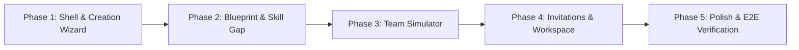

# MESH 2.0 — Frontend Implementation Roadmap & Integration Plan

**Scope:** Step-by-step development sequence following architectural sign-off.  
**Constraint:** Zero application code changes until approved.  

---

## 1. Phased Implementation Sequence

### Phase 1: App Shell Refactor & Project Creation Wizard Foundation (Day 1 - Morning)
- Refactor top header in `src/App.tsx` to add global **"Start a Project"** primary CTA button.
- Build `ProjectCreationWizard` container component with wizard steps ($1 \dots 4$).
- Implement `ProjectIdeaInput.tsx` (Stage 1) connecting to `api.suggestProjectBlueprint()`.
- **Exit Criteria:** Student can enter a project prompt and receive a structured `BlueprintSuggestion` on screen.

### Phase 2: Blueprint Editor & Skill Gap Visualizer (Day 1 - Midday)
- Implement `BlueprintEditor.tsx` (Stage 2) with inline requirement editing, proficiency pip selector, and `targetTeamSize` stepper.
- Implement `SkillRequirementChip.tsx` with editable states and importance toggles.
- Implement `SkillGapVisualizer.tsx` (Stage 3) computing covered requirements vs. open positions against the creator's logged-in profile.
- Connect save action to `api.replaceProjectRequirements()`.
- **Exit Criteria:** Student can customize blueprint requirements and clearly see covered vs. missing skills.

### Phase 3: Team Simulator & Candidate Cards (Day 1 - Afternoon)
- Rewrite `src/components/TeamBuilder.jsx` into TypeScript as `TeamSimulator.tsx` using MD3 design tokens.
- Implement `CandidateContributionCard.tsx` highlighting covered requirements, mutual availability status, and GitHub evidence.
- Build alternative selector (Alternatives 1, 2, 3) and slot-locking/pinning mechanics.
- Connect to Phase 2 team suggestions endpoint once deployed by Codex (with client-side fallback preview).
- **Exit Criteria:** Creator can compare explainable team combinations without arbitrary match percentages.

### Phase 4: Invitation Flow & Workspace Integration (Day 2 - Morning)
- Implement `InvitationModal.tsx` for dispatching personalized recruitment invites.
- Refactor `src/views/ProjectsView.tsx` into modular sub-views:
  - `ProjectList`: Active, recruiting, and draft projects.
  - `ProjectWorkspace`: Clean project overview, Discord room launcher, team roster, and Kanban tasks.
  - `ProjectInvitationTracker`: Displays pending, accepted, and declined collaborator invitations.
- **Exit Criteria:** Dispatched invitations display real lifecycle status; accepted candidates appear in the project roster.

### Phase 5: Error Hardening, Responsive Polish & E2E Testing (Day 2 - Afternoon)
- Audit all views for loading skeletons, network error banners, and empty states.
- Verify mobile responsiveness ($< 768\text{px}$) for the Team Simulator and Blueprint Editor.
- Conduct end-to-end user journey test with backend agent (Codex).
- Ensure `npm run build` passes with zero TypeScript warnings.
- **Exit Criteria:** Fully functional MESH 2.0 demo ready for institutional and student evaluation.

---

## 2. Coordination Matrix with Backend Agent (Codex)

| Frontend Milestone | Backend Dependency (Codex) | Hand-off Checkpoint |
| :--- | :--- | :--- |
| **Phase 1: Blueprint Suggestion** | `POST /project-blueprints/suggestions` | Already implemented and verified by Codex in Phase 1. Ready for frontend consumption. |
| **Phase 2: Save Requirements** | `PUT /projects/{id}/requirements` | Already implemented and verified by Codex in Phase 1. Ready for frontend consumption. |
| **Phase 3: Team Suggestions** | `POST /projects/{id}/team-suggestions` | In progress (Codex Phase 2). Frontend will use typed contract fixtures until backend verification completes. |
| **Phase 4: Invitations API** | `POST /projects/{id}/invitations` | In progress (Codex Phase 2). |

